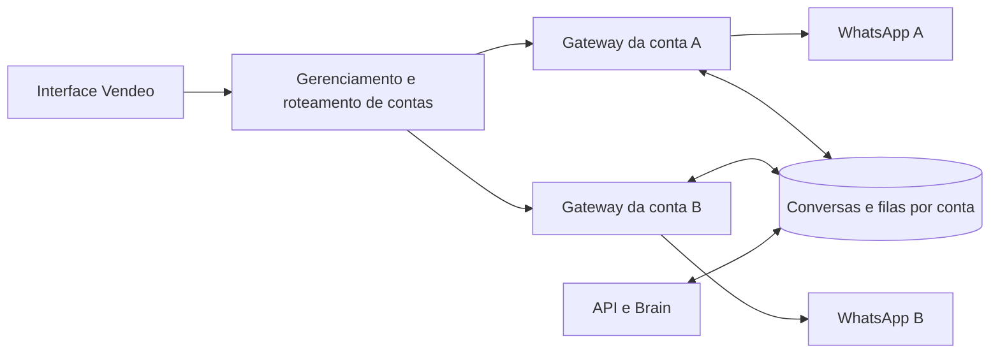

# Plano — múltiplas contas de WhatsApp no Vendeo

Data: 25/10/2026. Estado: implementação local em branch `codex/plano-multiplos-whatsapps`; não publicada.

## Estado após implementação local

Foi implementada uma primeira versão do gerenciamento de várias conexões: processos de gateway separados, sessão por conexão, roteamento interno, identificação de mensagens por conta, gerenciamento na configuração, seletor na caixa de entrada e escopo de conta para recursos de Status e rifas. A migração de Status é aditiva. Consulte [implementação e validação](implementation.md) para os arquivos, resultados e limites conhecidos.

Esta versão ainda não atende ao critério final deste plano: não foi pareada uma segunda conta real, não foram aplicadas migrações remotas, a autorização do cadastro multi-conta precisa de revisão para o ambiente publicado, fluxos legados sem conta explícita ainda precisam de auditoria, e não houve implantação nem conferência de API/site remotos. A troca de conta na interface não equivale a validação operacional simultânea.

## Objetivo e escopo

Permitir que o mesmo Vendeo mantenha dois ou mais números de WhatsApp conectados simultaneamente, com gerenciamento individual de conexão, conversas, envios e automação. O envio deve sempre usar a conta à qual a conversa pertence, mesmo que o operador troque a conta selecionada enquanto uma operação estiver em andamento.

A primeira entrega terá lista de contas, pareamento por número, identificação visual da conta e caixa de entrada filtrada pela conta selecionada. As demais contas continuarão recebendo mensagens e executando suas automações em segundo plano. Uma caixa de entrada unificada poderá ser uma entrega posterior; ela não é necessária para manter várias contas funcionando ao mesmo tempo.

O escopo inicial considera várias contas do mesmo ambiente Vendeo. Separação entre empresas ou clientes diferentes exige definição adicional de propriedade e permissões. As configurações hoje globais, como catálogos e persona, continuam compartilhadas nesta proposta; histórico, estado da IA e execução de atendimento devem permanecer associados à conversa de cada conta. Personas independentes por número ficam para uma evolução explícita.

## Base e evidências

A implementação deve partir da `main` atualizada, em branch `codex/`. O plano foi criado a partir de `origin/main`, commit `fdca9685`, após `git fetch origin main`.

A pasta original estava em `deploy/design-only`, com divergências da `main` e alterações pendentes em gateway, interface e API. Essas mudanças precisam ser comparadas individualmente com o que estiver publicado antes da implementação. Não mesclar a branch histórica inteira. Consultar `docs/deployments/2026-10-08-production-unification.md`.

Fatos identificados no código:

| Área | Situação atual | Implicação |
| --- | --- | --- |
| Identidade de conversa | `src/domain/entities/whatsapp2-account-scope.cjs` gera `wa2:account-<número>:<chat>` | Reaproveitar os IDs existentes; o mesmo contato em contas diferentes deve continuar separado. |
| Gateway | `services/whatsapp2-gateway/index.cjs` mantém um `client`, um `state`, uma `.session` e um `LocalAuth` fixo | Isolar o processo e a sessão de cada conexão. |
| Filas | Migrações `20261007112714` e `20261007112720` incluem `gateway_account_id` | Há uma base de roteamento por conta, mas isso não comprova isolamento de todas as tabelas auxiliares. |
| Cliente web | `whatsapp2-client.ts` resolve uma URL de gateway | Manter um ponto de entrada e incluir a conta no contexto das operações. |
| Configurações | `WhatsApp2ConnectionCard.tsx` controla uma conexão | Transformar a configuração em gerenciamento de várias conexões. |
| Caixa de entrada | `InstagramDirect.tsx` descobre uma conta pelo status do gateway | Introduzir seleção explícita de conta e estado independente de carregamento. |
| Entrega da API | `supabase/functions/api/whatsapp2_gateway.ts` associa entregas à conta da conversa | Preservar e ampliar a verificação em todas as operações. |

Esta análise não confirma a versão atual dos serviços remotos, as migrações efetivamente aplicadas nem a capacidade da máquina para múltiplos navegadores. Essas verificações fazem parte da primeira etapa.

## Arquitetura proposta

Usar um processo de gateway por conexão, gerenciado por um módulo central de contas e roteamento. Cada processo mantém seu cliente WhatsApp, navegador, caches, temporizadores, presença e sessão. O frontend acessa um único endereço público; o roteador resolve o processo correto internamente.

A escolha aproveita a organização atual do gateway, que possui muito estado de processo. Transformar todo esse estado em um conjunto de clientes dentro de um único processo aumentaria a superfície de alteração. O custo da proposta é manter mais de um processo e navegador, com consumo de recursos a medir.

O módulo central deve esconder localização de processos, portas internas, credenciais e reconexão. Sua interface deve oferecer gerenciamento de conexões e execução de operações com contexto de conta obrigatório. O frontend não deve escolher URLs arbitrárias de destino.

### Identidade e cadastro

Criar um cadastro persistente de conexões, com nome final definido durante a implementação, contendo:

- `connection_id`: identificador estável gerado antes do pareamento.
- `gateway_account_id`: identidade existente `account-<número>`, preenchida após confirmação pelo WhatsApp e única entre conexões cadastradas.
- Nome de exibição, habilitação, estado operacional, última atividade e último erro sanitizado.
- Referência interna para a instância; caminhos de sessão e segredos não devem integrar a resposta pública.

O número digitado no pareamento é uma solicitação, não prova da identidade conectada. Vincular a conta somente após confirmação pela sessão. Se o número real divergir de uma conexão já vinculada, bloquear o reaproveitamento automático e exigir um fluxo explícito de nova conexão. Impedir duas instâncias de consumir a fila da mesma conta por meio de exclusão mútua ou lease renovável.

O cadastro e a interface de gerenciamento devem usar o mecanismo de autorização real do projeto, a ser conferido na etapa inicial. Se o cadastro estiver no Supabase, definir políticas de acesso coerentes com esse mecanismo; credenciais privilegiadas permanecem no servidor. Não inventar um modelo de usuários ou organizações que ainda não exista.

### Contrato de roteamento

- Operações de conexão usam `connection_id`, pois podem ocorrer antes de existir um número confirmado.
- Operações sobre conversas usam a conta extraída do ID canônico da conversa. O servidor confronta essa identidade com o contexto solicitado e com a sessão ativa.
- Operações sem conversa, como publicar Status ou iniciar contato, exigem conta explícita e autorizada.
- Mensagens, mídia e eventos em tempo real transportam contexto de conta. Um ID do provedor sozinho não é suficiente para selecionar a conexão.
- Conta ausente, diferente, desconectada ou não autorizada resulta em erro identificável. Nunca encaminhar silenciosamente para a primeira conta disponível.
- Uma operação em andamento conserva o contexto em que foi iniciada; mudanças na seleção da interface não alteram o remetente.

## Etapas de implementação

### 1. Confirmar base, contratos e dependências

- [ ] Conferir `git status`, branches e worktrees; trabalhar a partir da `main` atualizada e preservar alterações de outras tarefas.
- [ ] Conferir diretamente site, API, gateway, configuração de túnel, inicialização e migrações aplicadas. Usar `node scripts/verify-production-baseline.mjs --live` como referência do release registrado, explicando diferenças intencionais.
- [ ] Mapear todas as chamadas de `whatsapp2-client.ts` e os consumidores de envio, mídia, presença, contatos, grupos, bloqueios, Status, transferência, finalização e rifa.
- [ ] Conferir autenticação, autorização, CORS e acesso aos eventos em tempo real, incluindo rotas de conexão.
- [ ] Auditar chaves e consultas de mensagens, transcrição, anexos, armazenamento, reações, recibos, Status, identidades de contatos, memória do Brain, outbox e idempotência. Identificar usos de `message_id`, telefone ou JID sem escopo de conta.
- [ ] Medir recursos com a conta atual e definir um limite operacional configurável. Validar inicialmente duas contas; não prometer quantidade ilimitada.

Saída: inventário dos pontos de alteração, diferenças em relação à produção e contratos que precisam de migração.

### 2. Cadastro e execução isolada

- [ ] Implementar cadastro de conexões e gerenciamento de estados: criada, iniciando, aguardando pareamento, conectada, reconectando, desconectada, erro e desabilitada.
- [ ] Tornar diretório de sessão, identificação do `LocalAuth`, porta interna e identificação do worker configuráveis por conexão.
- [ ] Implementar supervisão dos processos, descoberta da instância, verificação de saúde, reconexão com espera progressiva e limite de tentativas.
- [ ] Garantir que iniciar, reiniciar ou desconectar uma conta afete somente seu processo e sua sessão.
- [ ] Impedir execução duplicada da mesma conta; suspender o consumo de filas caso a instância perca sua autorização de execução.
- [ ] Adotar a sessão atual como primeira conexão, mantendo o caminho e identificador existentes inicialmente. Não copiar um perfil de navegador em uso nem exigir novo pareamento como procedimento padrão.
- [ ] Criar novas sessões em diretórios próprios e persistentes, fora dos artefatos públicos e dos arquivos versionados.

Saída: duas instâncias independentes, com estado e ciclo de vida controlados individualmente.

### 3. Roteamento, filas e dados

- [ ] Implementar o ponto único de entrada com resolução interna de conta para instância, mantendo os processos internos protegidos.
- [ ] Atualizar o cliente web para receber contexto explícito nas operações. Evitar uma variável global mutável de URL ou conta para decidir envios.
- [ ] Propagar conta em eventos e assinaturas; separar caches de chats, contatos, presença e mensagens na interface.
- [ ] Validar conta na criação, retirada e conclusão de trabalhos das filas, incluindo reprocessamento e recuperação após falha.
- [ ] Verificar idempotência no contexto de conta e conversa. Entregas de resultado incerto devem conservar o comportamento de reconciliação, sem reenvio automático indiscriminado.
- [ ] Aplicar somente as migrações necessárias identificadas na auditoria: índices, unicidade, metadados e referências. Preservar IDs canônicos existentes.
- [ ] Tratar registros legados `primary` ou sem conta somente quando houver evidência suficiente para atribuição. Registros ambíguos ficam bloqueados para envio e são relatados.
- [ ] Revisar limites globais e por conta de transcrição, envio e execução do Brain para evitar que uma conta monopolize o processamento.

Saída: todos os caminhos de leitura e escrita resolvem a conta correta, inclusive tarefas em segundo plano.

### 4. Gerenciamento e caixa de entrada

- [ ] Ler os guias pertinentes da versão instalada em `node_modules/next/dist/docs/` antes de escrever o frontend.
- [ ] Substituir a conexão única por uma lista com nome, número, estado, erro e ações individuais; acrescentar “Adicionar WhatsApp”.
- [ ] Reutilizar o pareamento por código para a conexão selecionada. Desconectar mantém o cadastro e o histórico; excluir histórico não faz parte dessa ação.
- [ ] Adicionar seletor de conta à caixa de entrada, com identificação clara do remetente no chat e no compositor.
- [ ] Carregar cada conta de forma independente; descartar respostas antigas após troca de seleção e impedir que eventos de outra conta alterem o chat aberto.
- [ ] Organizar rascunhos, paginação, seleção, carregamento e cache por conta e conversa.
- [ ] Permitir consulta ao histórico persistido de contas cadastradas quando a conexão estiver indisponível, identificando essa condição e impedindo envio direto indevido.
- [ ] Separar a composição visual em partes menores: lista de conexões, cartão de conta, pareamento e seletor. Evitar concentrar novas responsabilidades em `InstagramDirect.tsx`.

Saída: operador consegue conectar e alternar entre duas contas sem interromper o processamento da outra.

### 5. Automação e recursos associados

- [ ] Confirmar que ativação e pausa da IA, etapas, memória e histórico de execução usam a conversa canônica com conta.
- [ ] Garantir que Brain e agendadores funcionem para contas habilitadas independentemente da conta aberta na interface.
- [ ] Definir comportamento quando a conta fica offline: preservar trabalhos e prazos, limitar tentativas e respeitar expiração/cancelamento antes de retomar.
- [ ] Atualizar transferência entre canais e fluxos que iniciam conversa para exigir uma conta de destino explícita quando houver ambiguidade.
- [ ] Revisar publicação e visualização de Status, mídias, agenda de contatos, privacidade, bloqueios, grupos e presença para usar a sessão correspondente.
- [ ] Revisar venda, rifa e finalização: o envio pertence à conta da conversa; o compartilhamento de catálogos não autoriza unir históricos do mesmo telefone entre contas.

Saída: paridade dos recursos existentes, sem dependência da conta selecionada pelo operador.

### 6. Validação e disponibilização gradual

- [ ] Executar testes de comportamento nas interfaces dos módulos, cobrindo os cenários da matriz abaixo.
- [ ] Executar `node scripts/test-production-baseline.mjs`, as verificações pertinentes e o build do frontend. Testes experimentais devem ser apresentados separadamente.
- [ ] Fazer validação real somente com números e destinatários de teste autorizados, sem disparos para clientes.
- [ ] Implantar migrações aditivas e compatíveis antes do código que depende delas; disponibilizar cadastro, roteamento e gateway antes da nova interface.
- [ ] Manter uma opção de habilitação gradual. Primeiro validar a conta atual no novo gerenciamento; depois conectar a segunda conta de teste.
- [ ] Conferir diretamente as versões remotas e monitorar filas, falhas de identidade, reconexões, consumo de recursos e entregas incertas por conta.

## Matriz mínima de aceitação

| Cenário | Resultado exigido |
| --- | --- |
| Duas contas conectadas simultaneamente | Ambas recebem e enviam pelo próprio número. |
| Mesmo contato nas duas contas | Histórico, estado da IA e mensagens permanecem separados. |
| Troca de conta durante envio ou upload | A operação mantém a conta original. |
| Evento atrasado após troca de conta | Não altera o chat nem o rascunho da nova seleção. |
| Identificador de mensagem repetido entre contas | Nenhuma leitura, atualização ou mídia é atribuída à conta errada. |
| Conta A offline e B conectada | B continua funcionando; A não envia por B. |
| Reconexão e reinício do host | Sessões retomam individualmente, sem duplicar workers ou entregas. |
| Duas instâncias tentam usar a mesma conta | Somente uma pode assumir a execução. |
| Desconectar A | B permanece ativa e o histórico de A é preservado. |
| Pedido com conta divergente ou sem autorização | Operação recusada antes de acessar a sessão. |
| IA ativa em conta não selecionada | Atendimento continua pela conta correspondente. |
| Resultado de envio incerto | Não ocorre repetição automática sem reconciliação. |
| Recursos existentes | Texto, áudio, anexos, Status, contatos, bloqueios, rifa e finalização funcionam na conta escolhida. |
| Conta legada e registros ambíguos | Sessão atual preservada; registros sem atribuição comprovada não são enviados. |

## Observabilidade e reversão

Registrar conta, conexão e identificador de operação nos eventos técnicos, sem conteúdo sensível, credenciais ou códigos de pareamento nos logs. Acompanhar fila pendente, atraso, falhas, reconexões, conflitos de identidade e recursos por instância.

Em caso de regressão, desabilitar novas conexões, suspender consumidores das contas adicionais e reverter os artefatos para a versão validada. Preservar sessões, cadastro, histórico e migrações aditivas. Antes de retornar ao modo de conta única, impedir que filas de outras contas sejam consumidas pelo gateway antigo. Se houver envio incerto em andamento, reconciliar seu resultado antes de retomar consumidores.

## Critério de conclusão e limites

A funcionalidade estará concluída quando duas contas tiverem sido verificadas simultaneamente, todos os caminhos de envio respeitarem a identidade da conversa, a matriz de aceitação passar, o build e verificações exigidas estiverem aprovados e as versões publicadas forem conferidas diretamente.

A quantidade máxima suportada e o custo de infraestrutura serão definidos por medição. O prazo depende especialmente da auditoria de tabelas auxiliares, dos contratos de autorização e da reconciliação com a produção; este plano não presume que esses pontos já estejam resolvidos.
